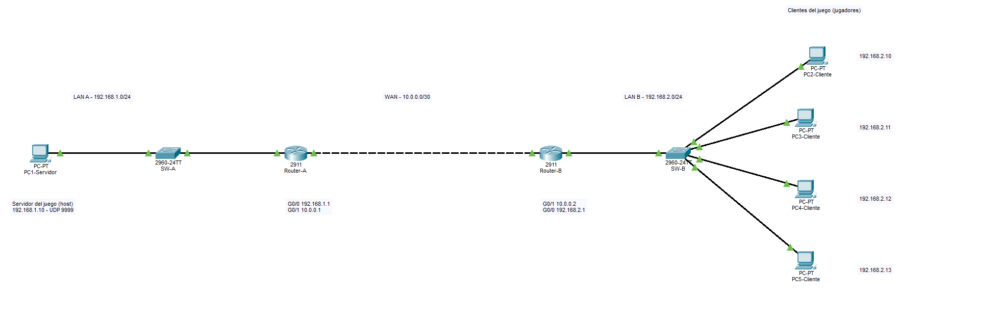

# LAN Shooter - Client-Server Architecture

## Description
An academic project developed for the Computer Networks course. It consists of a multiplayer third-person shooter that demonstrates the practical operation of a **Client-Server** architecture across two Local Area Networks joined by a WAN link between two routers. The project illustrates key networking concepts such as server authority, state synchronization, latency and routing, using the UDP protocol.

## Network Architecture
- **Topology:** PC1 (server) – LAN A – Router A – WAN – Router B – LAN B – PC2…PC5 (clients).
- **Local Host:** One machine simultaneously acts as the Server (physics and collision authority) and a Client.
- **Transport Protocol:** UDP port 9999 (ENet), optimized for low latency in real-time games.
- **Routing:** One static route per router, no NAT.

## How to Run
1. Open the project in Godot 4.7 and press F5.
2. On the server PC click **Crear partida (Host)**; the menu shows its local IP.
3. On the client PC type the server IP and port 9999, then click **Unirse**.

To try it on a single PC: Debug → Customize Run Instances → 2 instances, and join `127.0.0.1`.

Controls: WASD to move, mouse to look, left click to shoot, F3 for the network panel, Esc to release the mouse (Esc again to leave).

## Documentation
| File | Content |
|------|---------|
| [docs/red.md](docs/red.md) | Network design: topology, addressing table and routes |
| [docs/simulacion-packet-tracer.md](docs/simulacion-packet-tracer.md) | Cisco Packet Tracer simulation, router configuration and verification |
| [docs/red-lan-wan-lan.pkt](docs/red-lan-wan-lan.pkt) | Packet Tracer file (9.0.1) |
| [docs/prueba-real.md](docs/prueba-real.md) | Guide for the test with two physical PCs and routers |
| [docs/informe/main.tex](docs/informe/main.tex) | Project report in IEEE format (LaTeX, IEEEtran) |

## Technologies and Tools
- **Game Engine:** Godot 4.7 (3D)
- **Language:** GDScript
- **Network simulation:** Cisco Packet Tracer 9.0.1

## Authors
- Martin Pineda Jaramillo
- David Felipe Beltran Tabares
- Juan David Navarro Bermudez
