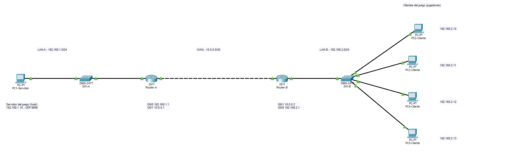

# Simulación en Cisco Packet Tracer

Archivo: [`red-lan-wan-lan.pkt`](red-lan-wan-lan.pkt) (Packet Tracer 9.0.1).
Implementa el diseño de [`red.md`](red.md).



## Dispositivos y cableado

| Dispositivo  | Modelo      | Puerto | Conecta con          | Cable    |
|--------------|-------------|--------|----------------------|----------|
| PC1-Servidor | PC-PT       | Fa0    | SW-A Fa0/1           | Directo  |
| SW-A         | 2960-24TT   | G0/1   | Router-A G0/0        | Directo  |
| Router-A     | 2911        | G0/1   | Router-B G0/1 (WAN)  | Cruzado  |
| Router-B     | 2911        | G0/0   | SW-B G0/1            | Directo  |
| SW-B         | 2960-24TT   | Fa0/1  | PC2-Cliente Fa0      | Directo  |
| SW-B         | 2960-24TT   | Fa0/2  | PC3-Cliente Fa0      | Directo  |
| SW-B         | 2960-24TT   | Fa0/3  | PC4-Cliente Fa0      | Directo  |
| SW-B         | 2960-24TT   | Fa0/4  | PC5-Cliente Fa0      | Directo  |

PC1-Servidor es el equipo que crea la partida (servidor y jugador). Los cuatro
PC de la LAN B representan a los jugadores que se conectan como clientes.

Los PC tienen IP estática: PC1 `192.168.1.10/24` con gateway `192.168.1.1`, y
PC2 a PC5 `192.168.2.10` a `192.168.2.13` (/24) con gateway `192.168.2.1`. Los
switches quedan con su configuración por defecto.

## Configuración de los routers

**Router-A**

```
enable
configure terminal
hostname Router-A
interface GigabitEthernet0/0
 description LAN A
 ip address 192.168.1.1 255.255.255.0
 no shutdown
 exit
interface GigabitEthernet0/1
 description Enlace WAN hacia Router-B
 ip address 10.0.0.1 255.255.255.252
 no shutdown
 exit
ip route 192.168.2.0 255.255.255.0 10.0.0.2
end
copy running-config startup-config
```

**Router-B**

```
enable
configure terminal
hostname Router-B
interface GigabitEthernet0/0
 description LAN B
 ip address 192.168.2.1 255.255.255.0
 no shutdown
 exit
interface GigabitEthernet0/1
 description Enlace WAN hacia Router-A
 ip address 10.0.0.2 255.255.255.252
 no shutdown
 exit
ip route 192.168.1.0 255.255.255.0 10.0.0.1
end
copy running-config startup-config
```

## Verificación

Tabla de rutas de Router-A (`show ip route`): la `S` es la ruta estática hacia la LAN B.

```
C       10.0.0.0/30 is directly connected, GigabitEthernet0/1
L       10.0.0.1/32 is directly connected, GigabitEthernet0/1
C       192.168.1.0/24 is directly connected, GigabitEthernet0/0
L       192.168.1.1/32 is directly connected, GigabitEthernet0/0
S    192.168.2.0/24 [1/0] via 10.0.0.2
```

Tabla de rutas de Router-B:

```
C       10.0.0.0/30 is directly connected, GigabitEthernet0/1
L       10.0.0.2/32 is directly connected, GigabitEthernet0/1
S    192.168.1.0/24 [1/0] via 10.0.0.1
C       192.168.2.0/24 is directly connected, GigabitEthernet0/0
L       192.168.2.1/32 is directly connected, GigabitEthernet0/0
```

Ping del cliente al servidor (desde PC2-Cliente):

```
C:\>ping 192.168.1.10
Reply from 192.168.1.10: bytes=32 time<1ms TTL=126
Reply from 192.168.1.10: bytes=32 time<1ms TTL=126
Reply from 192.168.1.10: bytes=32 time<1ms TTL=126
Reply from 192.168.1.10: bytes=32 time<1ms TTL=126

Packets: Sent = 4, Received = 4, Lost = 0 (0% loss)
```

El TTL llega en 126 (128 − 2): el paquete cruzó los dos routers.

Ruta que sigue el paquete (desde PC2-Cliente):

```
C:\>tracert 192.168.1.10
  1   0 ms      0 ms      0 ms      192.168.2.1    (Router-B)
  2   0 ms      0 ms      0 ms      10.0.0.1       (Router-A, lado WAN)
  3   0 ms      0 ms      0 ms      192.168.1.10   (PC1-Servidor)
Trace complete.
```

El ping en sentido contrario (PC1 → `192.168.2.10`) también responde con 0 % de pérdida.

Los cuatro clientes alcanzan al servidor:

| Origen      | IP            | Ping a 192.168.1.10        |
|-------------|---------------|----------------------------|
| PC2-Cliente | 192.168.2.10  | 4 de 4, 0 % de pérdida     |
| PC3-Cliente | 192.168.2.11  | 4 de 4, 0 % de pérdida     |
| PC4-Cliente | 192.168.2.12  | 4 de 4, 0 % de pérdida     |
| PC5-Cliente | 192.168.2.13  | 4 de 4, 0 % de pérdida     |

El `tracert` desde PC5-Cliente da los mismos tres saltos que desde PC2.

Nota: el primer ping tras encender la red puede perder uno o dos paquetes
mientras se resuelve ARP en cada salto; el segundo ya sale completo.

## Relación con el juego

Packet Tracer no ejecuta el juego, pero demuestra que la red lo permite: hay
conectividad IP de extremo a extremo entre cada cliente de la LAN B y el
servidor (`192.168.1.10`), que es lo único que necesita el tráfico UDP 9999 del
juego. No hay NAT ni listas de acceso que filtren ese puerto.
